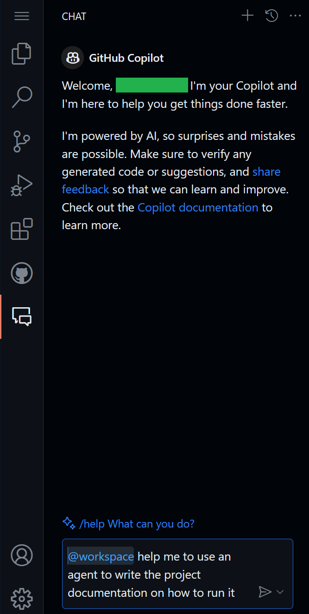

[](https://codespaces.new/MicrosoftDocs/mslearn-advanced-copilot)

# Apply advanced GitHub Copilot techniques
Discover new ways to leverage advanced GitHub Copilot techniques within a Python repository to implement an interactive HTML form and an Application Programming Interface (API) endpoint. 
Gain more practical experience by using this repository that contains a Python Web Application that hosts a Travel Weather API.

[](https://aka.ms/awesome-github-copilot)

## Requirements

1. Enable your [GitHub Copilot service](https://github.com/github-copilot/signup)
1. Open [this repository with Codespaces](https://codespaces.new/MicrosoftDocs/mslearn-advanced-copilot)

## Run in the configured Codespace

Open the Codespace using the link above and wait for the container build to
finish. You can run the existing application without completing the exercises
below.

### Python environment

The [development-container configuration](./.devcontainer/devcontainer.json)
uses Python 3.10 (`3.10-bullseye`). Its
[Dockerfile](./.devcontainer/Dockerfile) creates the virtual environment at
`/home/vscode/venv` and installs [requirements.txt](./requirements.txt),
including FastAPI, Uvicorn, and pytest, during the build. VS Code is configured
to use `/home/vscode/venv/bin/python`.

You do not need to create another virtual environment or install the
dependencies again. The commands below use the existing environment explicitly;
they do not require activating it or relying on the terminal's default Python.

### Automatic startup and private preview

When VS Code attaches to the Codespace, its `postAttachCommand` starts the
application automatically from the repository root:

```bash
/home/vscode/venv/bin/uvicorn --host 0.0.0.0 main:app --reload
```

Uvicorn listens on port **8000** and reloads when application code changes.
Do not start a second server while the automatic one is running. If you stop
the server with **Ctrl+C** in its terminal, run the command above from the
repository root to restart it.

Port 8000 is configured for forwarding with the label **Application**, and its
preview opens automatically when forwarded. If it does not open, use VS Code's
**Ports** tab, find port **8000**, and choose **Open in Browser** or the preview
action. Check that **Port Visibility** is **Private**; no public port is needed.
Use the forwarded URL from the Ports tab when opening the API in your browser.
The `0.0.0.0` server bind address does not require public port visibility.

Opening `/` redirects to `/docs`, where you can try the API interactively.

### Try the existing endpoints

The routes in [main.py](./main.py) read the case-sensitive keys from
[weather.json](./weather.json):

| GET path | Response |
| --- | --- |
| `/countries` | The available country/region names. |
| `/regions/{region}` | The city names for that region. |
| `/countries/{country}/{city}/{month}` | That city's monthly `high` and `low`. |

In `/docs`, expand `GET /regions/{region}`, select **Try it out**, enter
`Spain`, and select **Execute**. Equivalently, append `/regions/Spain` to the
forwarded URL. The HTTP 200 response is exactly:

```json
["Seville"]
```

Use the dataset's exact spelling and capitalization. An unknown region,
including lowercase `spain`, returns HTTP 404 with
`{"detail": "Region not found"}`. POST to the city-list route returns HTTP 405.
For monthly weather, the existing URL is
`/countries/Spain/Seville/January`, which returns `{"high": 61, "low": 41}`.

### Run the existing tests

From the repository root in a Codespace terminal, run:

```bash
/home/vscode/venv/bin/python -m pytest test_main.py
```

[test_main.py](./test_main.py) uses FastAPI's `TestClient`, so the tests do not
need a separately running Uvicorn server. Importing the application also
regenerates `.well-known/openapi.json`.

**Known current failure:** the monthly-weather test requests
`/regions/Spain/Seville/January`, but the application only registers monthly
weather under `/countries/{country}/{city}/{month}`. That test fails because
the requested URL returns 404 instead of 200; this is not a Codespace setup
problem.

## 💪🏽 Exercise
The current API is not exposing country/{country} which needs to be implemented to list cities. The route should allow only GET HTTP requests with a JSON response providing information from the historical high and low for that country, city, and given month.

As with any implementation, this addition should include at least one test function to work with the pytest runner and test framework. 

### 🛠 Step 1: Add a new route 
On our first exercise we will create a new route in our API. Go to the main.py file, and by using the inline chat with the following command `ctrl` + `i` (on Windows) or  `cmd` + `i`(on Mac) ask GitHub Copilot to help you create a new API that shows you the cities of a country. 

`> Create a new route that exposes the cities of a country.`


This prompt should give you something similar like this:


```python
# Create a new route that exposes the cities of a country:
@app.get('/countries/{country}')
def cities(country: str):
    return list(data[country].keys())

```
Note: Try your new route and refine your prompt until the result is as desired.

### 🔎 Step 2: Create a test
Now that you have created a new route, let's create a test with Copilot Chat for this route that uses Spain as the country. Remember to select your code and ask Copilot Chat to help you with this specific API that we just have created.

`> /tests help me to create a new test for this route that uses Spain as the country.`




Once Copilot has helped you to create your test, try it. If this is not functioning as expected, feel free to share those details with Copilot in the chat. For example:

`> This test is not quite right, it is not including cities that doesn't exist. Only Seville is part of the API.`


It should give you another solution. Keep trying until you achieve the desired result.

### 🐍 Step 3: Use an agent to write the project
During this step we will be using an agent (workspace) to write the project documentation on how to run this project. In the GitHub Copilot Chat, we will try the following prompt:

`> @workspace help me to use an agent to write the project documentation on how to run it .`

Finally, verify the new endpoint is working by trying it out by going to the `/docs` endpoint and confirming that the endpoint shows up.


🚀 Congratulations, through the exercise, you haven't only used copilot to generate code but also done it in an interactive and fun way! You can use GitHub Copilot to not only generate code, but write documentation, test your applications and more.


# Legal Notices

Microsoft and any contributors grant you a license to the Microsoft documentation and other content
in this repository under the [Creative Commons Attribution 4.0 International Public License](https://creativecommons.org/licenses/by/4.0/legalcode),
see the [LICENSE](LICENSE) file, and grant you a license to any code in the repository under the [MIT License](https://opensource.org/licenses/MIT), see the
[LICENSE-CODE](LICENSE-CODE) file.

Microsoft, Windows, Microsoft Azure and/or other Microsoft products and services referenced in the documentation
may be either trademarks or registered trademarks of Microsoft in the United States and/or other countries.
The licenses for this project do not grant you rights to use any Microsoft names, logos, or trademarks.
Microsoft's general trademark guidelines can be found at http://go.microsoft.com/fwlink/?LinkID=254653.

Privacy information can be found at https://privacy.microsoft.com/en-us/

Microsoft and any contributors reserve all other rights, whether under their respective copyrights, patents,
or trademarks, whether by implication, estoppel or otherwise.
